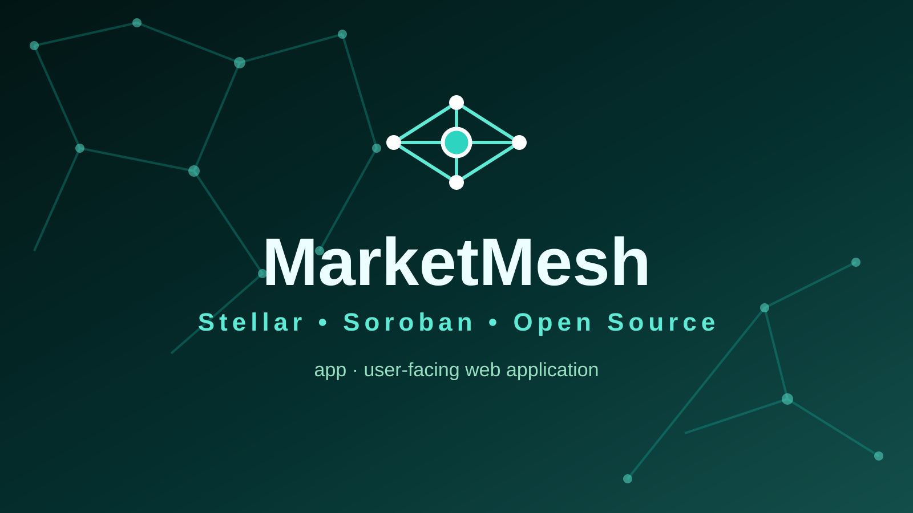
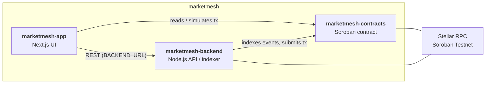

<p align="center">
  
</p>

<h1 align="center">MarketMesh — marketmesh-app</h1>

<p align="center"><i>Non-custodial marketplace settlement and escrow tooling.</i></p>

<p align="center">
[](LICENSE)
[](.github/workflows/ci.yml)
[](#tech-stack)
[](#security)
</p>

> ⚠️ **Scaffold pending** — the application code is not written yet; this repo currently holds the visual assets, bootstrap docs, and CI. Sections marked *TODO* will be filled when the scaffold lands.

## Why this exists

Non-custodial marketplace settlement and escrow tooling. This repository is the **user-facing web application** of the three-repo **MarketMesh** system.

## Where it fits

- [`marketmesh-contracts`](../marketmesh-contracts) — on-chain Soroban state and authorization.
- [`marketmesh-app`](../marketmesh-app) — user-facing web application. ← you are here
- [`marketmesh-backend`](../marketmesh-backend) — off-chain indexing/API and operational services.



## Features

- Branded visual identity (`assets/logo.svg`, `assets/social-preview.svg`) shared with the rest of the project
- Bootstrap scaffolding: CI workflow, issue/PR templates, `.env.example`, community docs
- Everything else is **TODO** — the Next.js app itself is not scaffolded yet

## Tech stack

| Layer | Choice (planned — matches sibling app repos) |
| --- | --- |
| Framework | Next.js 15.5 (App Router) |
| UI | React 19.1 |
| Language | TypeScript 5.8 (strict) |
| Stellar | `@stellar/stellar-sdk` 17.2.1 |
| Checks | `next lint`, `node --test` |

## Project structure

```text
marketmesh-app/
├── assets/                   # logo.svg, social-preview.svg
├── .env.example              # env template (matching sibling app repos)
├── .github/
│   ├── CODEOWNERS
│   ├── PULL_REQUEST_TEMPLATE.md
│   ├── ISSUE_TEMPLATE/
│   └── workflows/ci.yml
├── README.md
├── SECURITY.md / CONTRIBUTING.md / CODE_OF_CONDUCT.md / LICENSE
└── (app/ + lib/ + package.json — TODO: scaffold pending)
```

## Getting started

### Prerequisites

- Node.js 18+ and npm
- Access to Stellar Soroban Testnet RPC

### Installation

**TODO — scaffold pending.** There is no `package.json` yet, so there is nothing to install. The `.env.example` is already in place for when the app lands (keys documented below).

### Environment variables

| Key | Example | Purpose |
| --- | --- | --- |
| `STELLAR_NETWORK` | `testnet` | Target Stellar network |
| `STELLAR_RPC_URL` | `https://soroban-testnet.stellar.org` | Soroban RPC endpoint |
| `CONTRACT_ID` | *(empty)* | Id of the deployed Soroban contract this app talks to |
| `BACKEND_URL` | `http://localhost:8787` | Base URL of the sibling backend API |

### Running locally

**TODO — scaffold pending.** No `npm` scripts exist yet.

### Testing

**TODO — scaffold pending.** The CI workflow currently only validates repository files.

### Building / deploying

**TODO — scaffold pending**, and the hosting target is not defined yet.

## Roadmap

- Scaffold the Next.js app to parity with `openescrow-app` / `paybridge-app`
- Wallet connect + network switcher
- List/browse flows backed by the backend API
- Contract write path (escrow funding, release) via Soroban SDK

## Contributing

See [CONTRIBUTING.md](CONTRIBUTING.md) and [CODE_OF_CONDUCT.md](CODE_OF_CONDUCT.md).

## Security

See [SECURITY.md](SECURITY.md) for reporting guidelines.

> **Status: v0.1.0 — not audited, not production-ready.** Do not deploy with real funds.

## Maintainer

**Hikmaholadele** ([@Hikmaholadele](https://github.com/Hikmaholadele))

## License

Licensed under the [Apache License 2.0](LICENSE).
